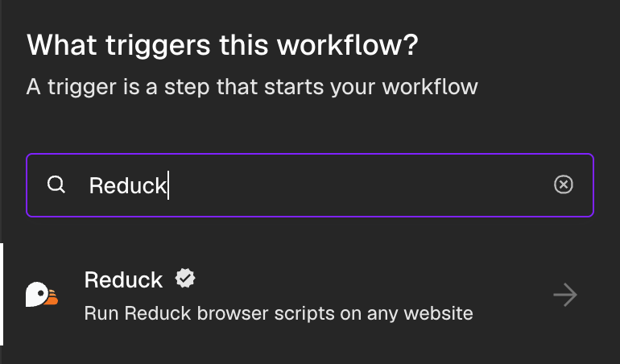
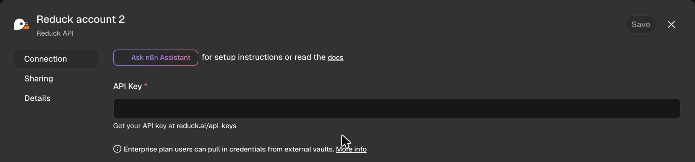
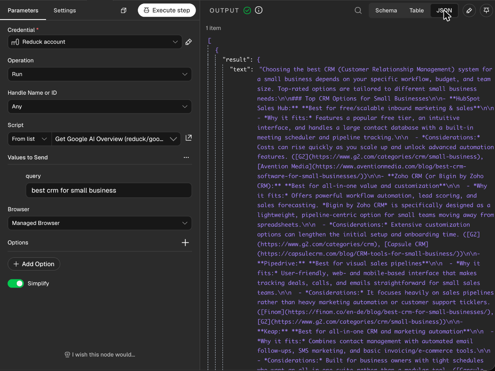
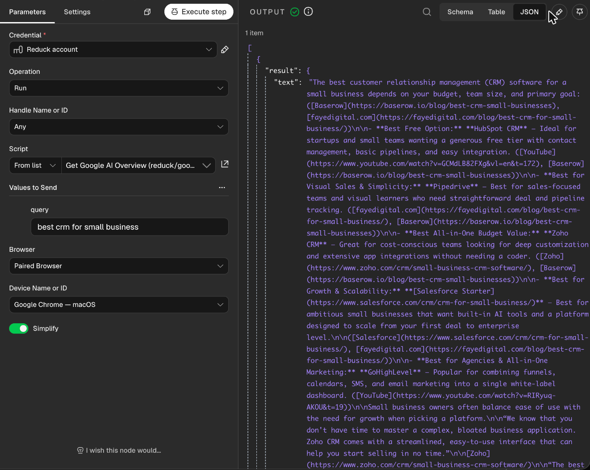

# Official [Reduck](https://reduck.ai) node for [n8n](https://n8n.io)

<p align="center">
  <picture>
    <source media="(prefers-color-scheme: dark)" srcset="https://raw.githubusercontent.com/reduck-ai/n8n-nodes-reduck/main/images/reduck-x-n8n-dark.png" />
    
  </picture>
</p>

n8n is a powerful automation framework but faces key challenges:

- **No API exists**, e.g. Facebook groups have none since 2024.
- **Hard to get APIs**, e.g. Reddit gives an API key only after reviewing applications.
- **Inadequate APIs**, e.g. Facebook's API reads only Pages you manage.
- **Hard to set up credentials**, e.g. Google requires you to make an OAuth app first.

Reduck solves this by making it easy to automate sites with no API by writing browser automation scripts with Agents and running them with a n8n node.


<p align="center"><em>Example of a workflow with Reduck for n8n to monitor brand visibility on a signed-in ChatGPT account with memory off</em></p>

With Reduck you can:

- Find LinkedIn profiles, qualify them and send connection requests.
- Read and post in Facebook groups.
- Search Reddit and read every comment of a thread.
- ... or create your own workflow on top of any site without API!

You can run scripts from the [Reduck library](https://reduck.ai/explore), or scripts that your
agent creates with Reduck MCP for custom integrations (see
[Build your own integrations](https://docs.reduck.ai/#build-your-own-integrations)).

A script runs in a browser. You choose which one in the node's **Browser** field:

- **Your paired browser**: your own Chrome, with the Reduck extension. The script uses your
  sessions, so it is signed in where you are. Chrome must be open.
- **A Reduck managed browser**: a browser in the Reduck cloud. It runs 24/7 without your
  computer.

> [!NOTE]
> A managed browser does not store any credentials and starts fresh, so it can only read public pages. The node does not run a script that requires login on it. We will provide cookie storage and reuse soon to allow to run scripts with managed browsers.

To choose between the two, see the [FAQ](#faq).

## Requirements

- An [n8n Cloud](https://app.n8n.cloud/register) workspace, or a [self-hosted n8n](https://docs.n8n.io/hosting/)
  where you can install community nodes.
- A [Reduck account](https://reduck.ai/#signin).
- The [Reduck extension](https://chromewebstore.google.com/detail/reduck/koccidjchcojlmgkdhibpgjbnhcoopio),
  paired with your account (see [pairing](https://docs.reduck.ai/#quick-start)). Scripts run on
  this browser by default. To run without it, set **Browser** to **Managed Browser**.

## Quick start

<!-- tabs -->

### n8n Cloud

Reduck is a verified node, so n8n Cloud can install it from the editor.

1. **Find the node.** In a workflow, select **+**, then search `Reduck`:

   

2. **Install it.** Select **Reduck**, then **Install node**. Then select the **Run script** action.

3. **Add your API key.** In **Credential**, select **Connect to Reduck**, paste a key from
   [API keys](https://reduck.ai/api-keys?utm_source=n8n&utm_medium=readme), and select **Save**:

   

4. **Run a script.** In **Script**, search `ai overview` and select **Get Google AI Overview**.
   In **query**, type a search, for example `best crm for small business`. In **Browser**,
   select **Managed Browser** if your extension is not paired. Then select **Execute step**.
   `result` holds the overview's answer and the pages it cites:

   

### CLI

1. **Stop n8n, then install the node.** You need n8n 2 or later, which runs on Node.js 24 or later:

   ```bash
   mkdir -p ~/.n8n/nodes && cd ~/.n8n/nodes && npm install @reduck-ai/n8n-nodes-reduck
   ```

2. **Add your API key as a credential.** Get a key from [API keys](https://reduck.ai/api-keys?utm_source=n8n&utm_medium=readme).
   n8n encrypts it when it imports the file:

   ```bash
   cat > reduck-credential.json <<EOF
   [{"id": "reduckQuickStart", "name": "Reduck API", "type": "reduckApi", "data": {"apiKey": "$REDUCK_API_KEY"}}]
   EOF
   n8n import:credentials --input=reduck-credential.json && rm reduck-credential.json
   ```

3. **Import and publish the workflow.** It answers a webhook with the Google AI Overview for a
   search. It runs on a Reduck managed browser, so you do not need the extension:

   ```bash
   curl -sO https://raw.githubusercontent.com/reduck-ai/n8n-nodes-reduck/main/examples/google-ai-overview-webhook.json
   n8n import:workflow --input=google-ai-overview-webhook.json
   n8n publish:workflow --id=reduckAiOverview
   ```

4. **Start n8n, then call the workflow** from another terminal. n8n reads published workflows
   only when it starts:

   ```bash
   n8n start
   ```

   ```bash
   curl "http://localhost:5678/webhook/ai-overview?q=best+crm+for+small+business"
   ```

   The answer is the run. `result` holds the overview's answer and the pages it cites, and `id`
   links to the run's steps and screenshots at `https://reduck.ai/runs/<id>`. If the run fails,
   the answer is `{ "error", "details" }`: what went wrong, and the link to the run.

### n8n editor

1. **Install the node**, then restart n8n:

   ```bash
   mkdir -p ~/.n8n/nodes && cd ~/.n8n/nodes && npm install @reduck-ai/n8n-nodes-reduck
   ```

   For Docker and other setups, see the
   [n8n guide](https://docs.n8n.io/integrations/community-nodes/installation/).

2. **Add your API key.** Add a **Reduck** node to a workflow. In **Credential**, select
   **Create new credential**, and paste a key from
   [API keys](https://reduck.ai/api-keys?utm_source=n8n&utm_medium=readme).

3. **Run a script.** In **Script**, search `ai overview` and select **Get Google AI Overview**.
   In **query**, type a search, for example `best crm for small business`. If you paired more
   than one browser, select yours in **Device**. Then select **Execute step**. The script runs on
   your paired browser, and `result` holds the overview's answer and the pages it cites:

   

<!-- /tabs -->

## Examples

Import a workflow from [examples](https://github.com/reduck-ai/n8n-nodes-reduck/tree/main/examples)
(**Workflows > Import from File**), then select your Reduck credential in its Reduck node.

- [ChatGPT brand monitoring](https://github.com/reduck-ai/n8n-nodes-reduck/blob/main/examples/chatgpt-brand-visibility.json):
  ask ChatGPT your buyers' questions daily, then record if each answer cites your site, names
  you, or cites other sites.
- [Google AI Overview API](https://github.com/reduck-ai/n8n-nodes-reduck/blob/main/examples/google-ai-overview-webhook.json):
  call a webhook with a search, then get Google's AI Overview and the pages it cites as JSON.
- [Reddit monitoring](https://github.com/reduck-ai/n8n-nodes-reduck/blob/main/examples/reddit-engage.json):
  scan specific subreddits daily, then analyze each thread and draft an answer with AI. You can
  approve, edit or reject each draft.
- [Doctolib booking](https://github.com/reduck-ai/n8n-nodes-reduck/blob/main/examples/doctolib-book-appointment.json):
check your doctors' free slots every hour, then book the earliest one in your dates and email
you.
- [Discord channel alerts](https://github.com/reduck-ai/n8n-nodes-reduck/blob/main/examples/discord-channel-alerts.json):
  read the Discord channels you are in every 15 minutes, then email you their new messages from
  your Gmail.
- [Alert to automatic purchase](https://github.com/reduck-ai/n8n-nodes-reduck/blob/main/examples/alert-to-purchase.json):
  receive a back-in-stock alert on a webhook, check the price and the stock, then order it once
  under your limits, or tell you when it needs you.

## FAQ

<details>
<summary>Paired browser or managed browser?</summary>

|              | Paired browser                  | Managed browser                                |
| ------------ | ------------------------------- | ---------------------------------------------- |
| Volume       | Under ~100 script runs per hour | Deployment at scale                            |
| Cost         | Cheaper                         | More expensive                                 |
| Credentials  | Never leave your browser        | None: public pages only                        |
| Availability | Needs your browser open         | 24/7                                           |
| Network      | Your connection                 | Datacenter, or a home address per **Country**  |

If a site refuses the managed browser, set **Country** in **Options**: the browser then connects from a home
address in that country, not from a datacenter.

</details>

<details>
<summary>Do my items run at the same time?</summary>

Yes, each in its own browser, up to the limit of the browser, and the output stays in the order of
the items. To run them one at a time, for example on a site that watches your pace, put a **Loop
Over Items** node with a batch size of 1 before the Reduck node.

</details>

<details>
<summary>What happens when a site signs me out?</summary>

The run fails and says that the browser is not signed in. Sign in to the site again in your
browser, and the next run works.

</details>

<details>
<summary>How much does it cost?</summary>

Reduck has a free plan. See [pricing](https://reduck.ai/pricing).

</details>